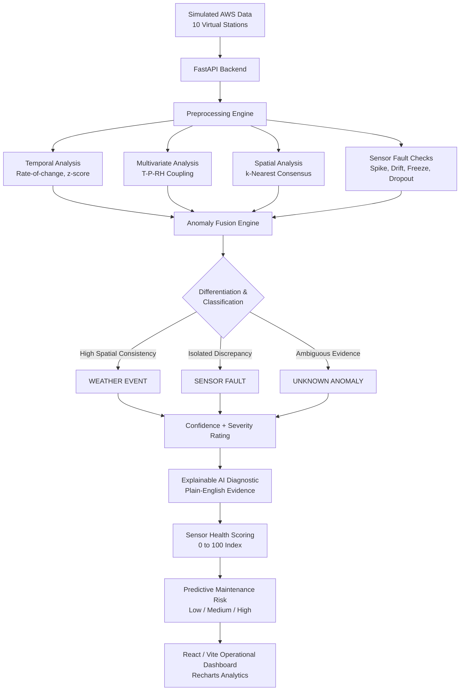

# SkyGuard AI

**AI/ML-Based Intelligent Anomaly Detection for Automatic Weather Stations (AWS)**  
*Smart India Hackathon (SIH) – Problem Statement ID: SIH26073*

---

## 1. Problem Statement

Automatic Weather Stations (AWS) deployed across meteorological networks deliver real-time observations critical for weather forecasting, disaster mitigation, aviation, and agriculture. However, automated sensors are susceptible to hardware malfunctions, calibration loss, physical transducer damage, communication packet dropouts, and environmental fouling.

### The Fundamental Meteorological Challenge:
Distinguishing between:
1. **A Genuine Weather Event:** (e.g., rapid heatwaves, convective storm gust fronts, microbursts, or cold fronts)
2. **A Sensor/Data Fault:** (e.g., thermistor short circuits, amplifier drifting, telemetry freeze, or communication failure)

### Core Meteorological Principle:
> *"A genuine weather event generally produces temporally and/or spatially consistent changes across neighboring stations, while a sensor fault may appear as an isolated, inconsistent, frozen, drifting, or abrupt signal."*

Without intelligent discrimination, erroneous sensor spikes cause false weather alarms, while unflagged sensor failures corrupt national meteorological numerical weather prediction (NWP) models.

---

## 2. Solution: SkyGuard AI

**SkyGuard AI** implements an end-to-end intelligent operational architecture following the five-stage paradigm:

$$\text{DETECT} \longrightarrow \text{DIFFERENTIATE} \longrightarrow \text{EXPLAIN} \longrightarrow \text{MONITOR} \longrightarrow \text{PREDICT}$$

- **DETECT:** Continuously monitors multi-station sensor streams (Temperature, Pressure, Relative Humidity) using statistical limits, temporal slopes, and unsupervised machine learning.
- **DIFFERENTIATE:** Fuses spatial correlation networks and thermodynamic physics to separate isolated instrument glitches from spatially coherent atmospheric dynamics.
- **EXPLAIN:** Delivers transparent, non-black-box reasoning (XAI) with plain-English evidence bullets, confidence ratings, and root-cause summaries understandable by operators and judges.
- **MONITOR:** Aggregates real-time sensor health scores (0–100) and quantifies maintenance risk to prevent instrument outages.
- **PREDICT:** Evaluates sensor drift trajectories to recommend proactive recalibration prior to catastrophic failure.

---

## 3. How It Works: Multi-Tier Processing Pipeline

```
AWS Data
   ↓
Preprocessing (Diurnal baseline & moving window)
   ↓
+-----------------------------------------------------------+
| Multi-Signal Feature Extraction:                          |
| 1. Temporal Analysis (Rate-of-change & rolling z-score)   |
| 2. Spatial Analysis (Haversine k-nearest neighbor consensus)|
| 3. Multivariate Physics (Psychrometric T-P-RH coupling)   |
| 4. Sensor Behavior (Spike, linear drift, frozen test)     |
| 5. Isolation Forest (Multi-feature space partitioning)    |
+-----------------------------------------------------------+
   ↓
Anomaly Fusion Engine (Weighted composite anomaly scoring)
   ↓
Classification & Differentiation
   ├── Spatially consistent cluster shift → WEATHER EVENT
   ├── Isolated departure / unphysical jump → SENSOR FAULT
   └── Indeterminate evidence → UNKNOWN ANOMALY
   ↓
Confidence (0–100%) & Severity (Low, Medium, High, Critical)
   ↓
Explainability Engine (Plain-English validated evidence bullets)
   ↓
Sensor Health Score (0–100) & Predictive Maintenance Risk Assessment
   ↓
Interactive React Operational Dashboard
```

---

## 4. Architecture Diagram



---

## 5. Technology Stack (Zero-Database Local Setup)

- **Frontend:** React 19, TypeScript, Vite, Tailwind CSS v4, Recharts, Lucide Icons.
- **Backend:** Python 3.12, FastAPI, Uvicorn, Pydantic v2.
- **Machine Learning & Data:** Pandas, NumPy, scikit-learn (Isolation Forest), SciPy.
- **Storage:** **NO DATABASE** (No PostgreSQL, MongoDB, InfluxDB, Firebase, Supabase, or AWS required). 100% in-memory with automatic self-healing JSON persistence.

---

## 6. Getting Started Locally

### Prerequisites
- Python 3.10+
- Node.js 18+ and npm

### 1. Start Backend Server
```bash
cd backend
pip install -r requirements.txt
python -m uvicorn app.main:app --host 127.0.0.1 --port 8000
```
*Backend runs at:* `http://127.0.0.1:8000`  
*API Swagger Documentation:* `http://127.0.0.1:8000/docs`

### 2. Start Frontend Dashboard
In a new terminal:
```bash
cd frontend
npm install
npm run dev
```
*Frontend runs at:* `http://127.0.0.1:5173/`

---

## 7. Interactive Judge Demonstration Guide

The dashboard includes a dedicated **Judge Demo Mode** with 1-click presets:

### Demo 1: Single Station Sensor Spike
1. On the dashboard, click **"Demo 1: Sensor Spike"** (or select AWS-003, Scenario: Sensor Spike, click **START SIMULATION**).
2. **Observation:**
   - AWS-003 immediately jumps to **55.0°C**.
   - Surrounding AWS stations (AWS-001, AWS-002, AWS-004) remain normal (~31°C).
   - System flags **ANOMALY DETECTED**.
   - System categorizes as **SENSOR FAULT (SENSOR SPIKE)** with **98% Confidence** and **HIGH Severity**.
   - **XAI Explanation:** *"Station AWS-003 reported an abrupt temperature of 55°C, significantly deviating from nearby AWS stations while surrounding stations remained stable. Spatial isolation confirmed."*

### Demo 2: Regional Weather Event
1. Click **"Demo 2: Weather Event"**.
2. **Observation:**
   - AWS-003 and multiple nearby stations (AWS-001, AWS-002, AWS-004, AWS-008) increase synchronously from 31°C to ~37°C, with atmospheric pressure dropping across the cluster.
   - System flags **ANOMALY DETECTED**.
   - System correctly differentiates: **WEATHER EVENT (REGIONAL WEATHER SHIFT)** with **96% Confidence**.
   - Sensor health score remains protected (**100/100**) because nature—not hardware—caused the shift.

### Demo 3: Gradual Sensor Drift
1. Click **"Demo 3: Sensor Drift"**.
2. **Observation:**
   - AWS-003 values steadily drift away from expected baseline (31 → 33 → 35 → 37 → 39°C) while neighbors stay steady.
   - System detects monotonic linear drift: **SENSOR FAULT (SENSOR DRIFT)**.
   - Sensor Health drops to **64/100**; Maintenance Risk escalates to **MEDIUM/HIGH** with recommendation to *"Schedule field calibration inspection"*.

### Demo 4: Frozen Sensor
1. Click **"Demo 4: Frozen Sensor"**.
2. **Observation:**
   - Station outputs repeated identical readings (31.2°C) without environmental micro-variance.
   - System detects telemetry lock: **SENSOR FAULT (FROZEN SENSOR)**.
   - Maintenance Risk escalates to **HIGH**.

### Demo 5: Missing Telemetry / Offline
1. Click **"Demo 5: Missing Data"**.
2. **Observation:**
   - AWS-003 stops transmitting; status transitions to **OFFLINE**.
   - System triggers **SENSOR FAULT (MISSING DATA / COMMUNICATION FAILURE)**.

### Reset Anytime:
Click **"RESET"** to restore all stations to nominal baseline without restarting the server.

---

## 8. Verification & Test Suite

Run the automated backend test suite covering all 6 mandatory SIH test cases:
```bash
cd backend
python test_cases.py
```
**Test Results:**
```
============================================================
RUNNING SKYGUARD AI BACKEND VALIDATION SUITE
============================================================
[TEST 1] Testing Normal Data Baseline...           -> PASS (NORMAL)
[TEST 2] Testing Sensor Spike (AWS-003 = 55°C)... -> PASS (SENSOR FAULT - SPIKE, Conf: 98.0%)
[TEST 3] Testing Weather Event (Cluster Surge)... -> PASS (WEATHER EVENT, Conf: 96.0%)
[TEST 4] Testing Sensor Drift (Monotonic climb).. -> PASS (SENSOR DRIFT, Health < 80)
[TEST 5] Testing Frozen Sensor (Constant 31.2°C). -> PASS (FROZEN SENSOR, Risk HIGH)
[TEST 6] Testing Missing Data (Telemetry drop)... -> PASS (OFFLINE - MISSING DATA)
[TEST 7] Testing Simulation Reset............... -> PASS (Restored to NORMAL)
============================================================
ALL 6 MANDATORY TEST CASES PASSED SUCCESSFULLY!
============================================================
```

---

## 9. Project File Structure

```
skyguard-ai/
├── backend/
│   ├── app/
│   │   ├── api/
│   │   │   ├── __init__.py
│   │   │   └── routes.py
│   │   ├── ml/
│   │   │   ├── __init__.py
│   │   │   ├── detector.py
│   │   │   ├── temporal.py
│   │   │   ├── spatial.py
│   │   │   ├── multivariate.py
│   │   │   ├── sensor_checks.py
│   │   │   └── explain.py
│   │   ├── models/
│   │   │   ├── __init__.py
│   │   │   └── schemas.py
│   │   ├── services/
│   │   │   ├── __init__.py
│   │   │   ├── data_service.py
│   │   │   └── health_service.py
│   │   ├── simulation/
│   │   │   ├── __init__.py
│   │   │   └── simulator.py
│   │   └── main.py
│   ├── data/
│   │   ├── stations.json
│   │   └── readings.json
│   ├── requirements.txt
│   └── test_cases.py
│
├── frontend/
│   ├── src/
│   │   ├── components/
│   │   │   ├── Navbar.tsx
│   │   │   ├── StatsCards.tsx
│   │   │   ├── SimulationPanel.tsx
│   │   │   ├── StationTable.tsx
│   │   │   ├── ExplainabilityPanel.tsx
│   │   │   ├── AlertsPanel.tsx
│   │   │   ├── ChartsSection.tsx
│   │   │   └── StationDetailModal.tsx
│   │   ├── services/
│   │   │   └── api.ts
│   │   ├── types/
│   │   │   └── index.ts
│   │   ├── App.tsx
│   │   ├── main.tsx
│   │   └── index.css
│   ├── package.json
│   └── vite.config.ts
│
├── test_e2e_api.py
└── README.md
```
"# sih-demo-" 
